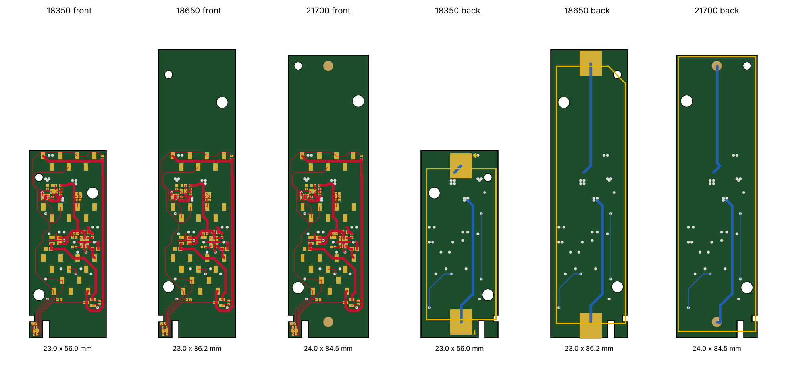
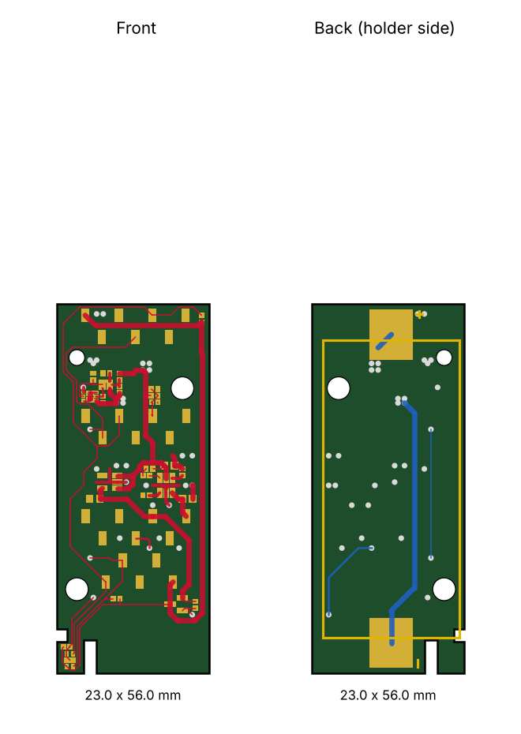
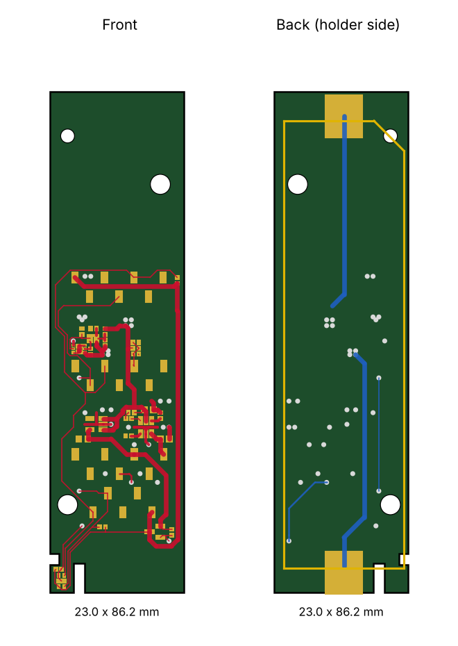
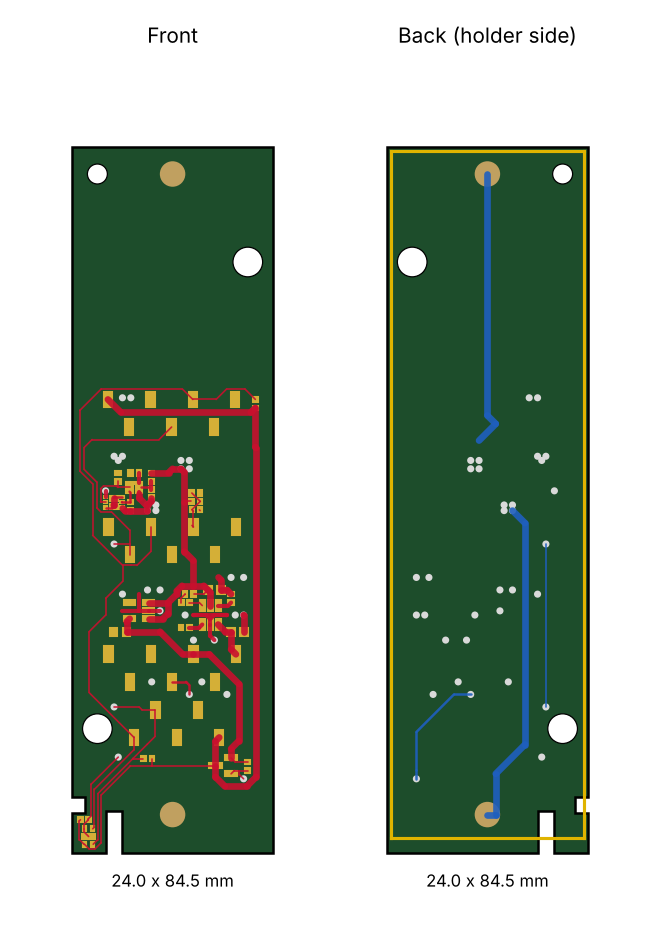
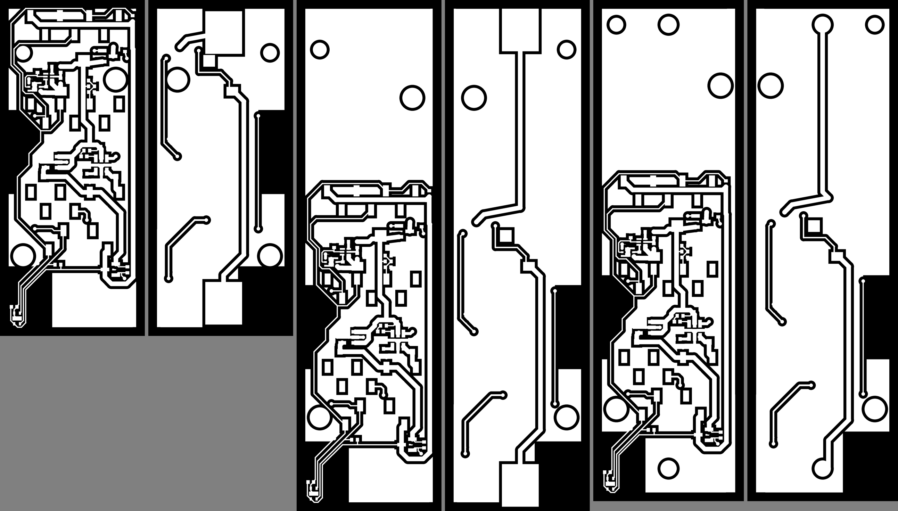

# Smart Sensor Battery Pack (18350 / 18650 / 21700)

A small battery board for a Seeed XIAO microcontroller and an SHTC3 temperature and humidity sensor, for building wireless sensors that run on a single lithium-ion cell. The XIAO plugs into sockets on the front, and the cell sits in a holder on the back.

This is a fork of [FeatureNAB/smart-sensor-battery-pack](https://github.com/FeatureNAB/smart-sensor-battery-pack). It adds two larger battery sizes (18650 and 21700), a few protection and power improvements, and ready-to-use ESPHome firmware for Home Assistant. All three boards share the same circuit and front-side layout. The full list of changes is under [Changes from the original design](#changes-from-the-original-design).

The original design, with the build, design theory and assembly, is explained in this video:

[](https://www.youtube.com/watch?v=-wEKOhVZ0NM)

## Thank you
A big thank you to **FeatureNAB** for designing this board and sharing it openly, along with the video that explains how and why it works. The charging, protection and sensor-isolation design, the compact layout, and the KiCad project are all their work. This fork only builds on that foundation. If you find this useful, please watch and support the [original video](https://www.youtube.com/watch?v=-wEKOhVZ0NM) and [repository](https://github.com/FeatureNAB/smart-sensor-battery-pack).

## Changes from the original design
**New board sizes**
- **18650 board** (`variants/18650/`): Keystone 1042 holder, 23 x 86.25 mm.
- **21700 board** (`variants/21700/`): Keystone 1121 holder (also fits 20700), 24 x 84.55 mm.
- **Variant generator** (`tools/make_variant.py`): rebuilds the larger boards from the 18350 master after any change, swaps the holder, resizes the outline and checks that the holder's holes clear existing copper.

**Circuit changes (all three boards)**

| Part | Original | This fork | Why |
|------|----------|-----------|-----|
| Q2 (new) | — | AO3401A P-MOSFET in the battery + line | Protects everything if the cell is inserted backwards |
| U4 regulator | TPS7A05 (200 mA) | RT9080-33GJ5 (600 mA, 2 µA quiescent) | The ESP32-C6 draws up to 354 mA when Wi-Fi transmits; same footprint and pinout |
| C3 (3.3 V cap) | 2.2 µF | 10 µF | Absorbs Wi-Fi current bursts |
| R2 (charger TS) | 10 kΩ fixed resistor | 10 kΩ NTC thermistor, moved away from the charger | Stops charging when too cold or hot; the fixed resistor disabled this |
| R1 (charge current) | 1.2 kΩ (450 mA) | 18350: unchanged. 18650 and 21700: 910 Ω (about 590 mA) | Larger cells finish charging inside the charger's 10-hour safety timer |
| U1 (schematic) | XIAO nRF52840 | XIAO ESP32-C6 | Matches the firmware; the sockets are the same |

The 18350 board keeps its original size and front layout; Q2 and the moved thermistor fit in free space in the top-right corner.

**Firmware and Home Assistant (new)**
- **ESPHome config** for the XIAO ESP32-C6 (`firmware/`) with deep sleep, sensor power sequencing, internal I2C pull-ups disabled and pins released before sleep, so the sensor is never powered through its data lines.
- **Home Assistant package** (`homeassistant/`) adding a "stay awake" toggle for over-the-air updates, plus a secrets template.

**Manufacturing files (new)**
- **Gerber zips** for all three boards in `gerbers/`, generated by `tools/make_gerbers.py` and checked for shorts and broken connections.
- **JLCPCB assembly files** (BOM with LCSC part numbers, and placement files) in `assembly/`; the schematics now carry LCSC numbers for the new parts.

**Documentation**
- **I2C note corrected:** the original note said pull-ups were missing. R9 and R10 are already in the design, on the switched sensor rail.
- **README rewritten:** board descriptions, comparison images, setup steps and known limitations.


## Quick start
Here's everything you need to build one, in order:

1. **Pick a board size:** 18350 (smallest), 18650 or 21700 (longest runtime). See [The three designs](#the-three-designs).
2. **Order the board:** upload that board's Gerber zip from [`gerbers/`](gerbers) to JLCPCB. Optionally add assembly with the matching BOM and placement files from [`assembly/`](assembly); see [Ordering boards](#ordering-boards-gerber-files).
3. **Buy the parts that aren't on the board order:**
   - The **battery holder** for your size, from DigiKey (see [Battery holders](#battery-holders)).
   - A **Seeed XIAO ESP32-C6** ([product wiki](https://wiki.seeedstudio.com/xiao_esp32c6_getting_started)).
   - A **lithium-ion cell** (see [Batteries](#batteries)).
4. **Solder the holder, then check the board** before inserting a cell (see [Assembly and first power-up](#assembly-and-first-power-up)).
5. **Flash the firmware and add the sensor to Home Assistant** (see [Firmware](#firmware-esphome-xiao-esp32-c6)).
6. **Optionally plug in a second sensor** (see [Adding other sensors](#adding-other-sensors)).

## What the board does
- **Microcontroller:** made for a Seeed **XIAO ESP32-C6**. The board uses D2 (GPIO2) for battery voltage, D4/D5 (GPIO22/23) for I2C and D10 (GPIO18) to switch the sensor power.
- **Charging:** a BQ21040 charges the cell from the XIAO's USB 5 V, and an LED shows charge status. R1 sets the charge current: 450 mA on the 18350 board and about 590 mA on the 18650 and 21700 boards, so a full charge fits inside the charger's 10-hour safety timer.
- **Battery temperature:** a 10 kΩ NTC thermistor (R2, Murata NCP15XH103F03RC) on the charger's TS pin stops charging when the board is too cold or too hot for lithium-ion. It sits in the corner furthest from the charger so the charger's own heat doesn't trip it.
- **Reverse-battery protection:** a P-channel MOSFET (Q2, AO3401A) in series with the cell's + terminal, with its gate on the cell's − terminal. A correctly inserted cell turns it fully on in both directions, for charging and discharging. A reversed cell leaves it off, and its body diode blocks the current.
- **Cell protection:** a BQ29700 protector with a CSD85301Q2 dual MOSFET guards against over-charge, over-discharge and over-current.
- **Power:** an RT9080-33GJ5 regulator (600 mA, 2 µA quiescent current) supplies 3.3 V to the XIAO. That covers the ESP32-C6's Wi-Fi transmit peaks (up to 354 mA at full power) with headroom, and a 10 µF capacitor (C3) on 3.3 V absorbs the bursts.
- **Battery monitoring:** a 5.1 MΩ / 5.1 MΩ divider brings the battery voltage to a XIAO analog pin (BATT_SENSE) and draws about 0.4 µA.
- **Switched sensor power:** a P-channel MOSFET (Q1, AO3401A) lets the XIAO turn the sensor rail (3V_SW) off between readings. The I2C pull-ups (R9, R10) are on that rail too, so nothing on the sensor side draws current while the XIAO sleeps.
- **Sensor:** an SHTC3 sits on a slotted tab at the bottom edge, thermally isolated from the rest of the board, with an extra socket for a plug-in I2C sensor.

## The three designs
All three boards share the same schematic and the same front-side parts and routing. Only the holder on the back, the board outline and the two battery traces change. The extra length is added at the BAT+ end, so the sensor tab stays where it is.



| Cell | Holder (back side) | Holder mounting | Board size | KiCad project |
|------|--------------------|-----------------|------------|---------------|
| 18350 | Keystone 1096 | Surface mount | 23 x 56 mm | repository root (original design) |
| 18650 | Keystone 1042 | Surface mount | 23 x 86.25 mm | `variants/18650/` |
| 21700 | Keystone 1121 (fits 20700 and 21700) | Through-hole solder lugs | 24 x 84.55 mm | `variants/21700/` |

### 18350
The original, most compact design. The Keystone 1096 holder covers the whole back of the board.



### 18650
The same board stretched to 86.25 mm for a Keystone 1042 holder. The holder's locating holes are placed to clear all existing copper. The BAT- pad overhangs the bottom edge by 0.25 mm, which DRC will flag; the original board overhangs its BAT+ pad by 0.95 mm in the same way.



### 21700
Uses a Keystone 1121 holder. The holder is 23.06 mm wide, so the board is 1 mm wider than the original, with the extra width on the right so the sensor tab is unchanged. The holder's solder lugs go through the board and are soldered from the front.

The footprint was drawn from Keystone drawing 1121 rev A. The lug holes are drilled 1.7 mm instead of the drawing's 1.32 mm, because the drawing gives the lug pin itself as 1.57 mm. Check a lug against the hole before ordering.



## Ordering boards (Gerber files)
Ready-to-upload Gerber zips for all three boards are in [`gerbers/`](gerbers):

| Board | File | Size |
|-------|------|------|
| 18350 | [`gerbers/SSB-18350-gerbers.zip`](gerbers/SSB-18350-gerbers.zip) | 23 x 56 mm |
| 18650 | [`gerbers/SSB-18650-gerbers.zip`](gerbers/SSB-18650-gerbers.zip) | 23 x 86.25 mm |
| 21700 | [`gerbers/SSB-21700-gerbers.zip`](gerbers/SSB-21700-gerbers.zip) | 24 x 84.55 mm |

**To order at JLCPCB:** upload a zip on the quote page and keep the defaults: 2 layers, 1.6 mm FR-4, 1 oz copper. Choose any solder-mask colour. Each zip holds both copper layers, solder mask, paste, silkscreen, the board outline, and plated and non-plated drill files.



*Copper as written to the Gerbers (white = copper), front and back for 18350, 18650 and 21700. The back views are mirrored as if the board were flipped over.*

### Assembled by JLCPCB (BOM and placement files)
To have JLCPCB solder the parts, choose **PCB Assembly** (top side) on the quote page, then upload the BOM and placement (CPL) files for the same board from [`assembly/`](assembly):

| Board | BOM | Placement |
|-------|-----|-----------|
| 18350 | [`SSB-18350-BOM.csv`](assembly/SSB-18350-BOM.csv) | [`SSB-18350-CPL.csv`](assembly/SSB-18350-CPL.csv) |
| 18650 | [`SSB-18650-BOM.csv`](assembly/SSB-18650-BOM.csv) | [`SSB-18650-CPL.csv`](assembly/SSB-18650-CPL.csv) |
| 21700 | [`SSB-21700-BOM.csv`](assembly/SSB-21700-BOM.csv) | [`SSB-21700-CPL.csv`](assembly/SSB-21700-CPL.csv) |

Every part except the battery holder uses a JLCPCB/LCSC part number:

| Part | Designator | LCSC # |
|------|-----------|--------|
| Charger BQ21040DBVR | U2 | C202311 |
| Protector BQ29700DSER | U5 | C183096 |
| Dual MOSFET CSD85301Q2 | U6 | C544396 |
| Regulator RT9080-33GJ5 | U4 | C841192 |
| P-MOSFET AO3401A | Q1, Q2 | C15127 |
| SHTC3 sensor | U7 | C194656 |
| 10 kΩ NTC (Murata NCP15XH103F03RC) | R2 | C77131 |
| 10 µF 0603 | C3 | C19702 (basic part) |
| 2.2 µF 0603 | C1, C2 | C23630 (basic part) |
| 100 nF 0402 | C4, C5, C6 | C1525 |
| Charge-current resistor | R1 | 1.2 kΩ C25862 (18350), 910 Ω C4129882 (18650, 21700) |
| Other 0402 resistors, LED | R3–R12, D1 | see the BOM files |
| XIAO sockets 1x7 / 1x5 SMD | J1, J2, J3 / J5 | C42379199 / C42379198 |

Things to know before ordering assembly:
- **Battery holder:** BT1 is not in the BOM, so buy it separately and solder it yourself (see [Battery holders](#battery-holders) below).
- **Extended parts:** most of the ICs are JLCPCB "extended" parts, which carry a small one-time loading fee each. Stock changes, so the quote page will flag anything that has run out.
- **Check rotations:** in JLCPCB's placement preview, check the part rotations, especially the SOT-23 and WSON parts and the sockets. Their library sometimes uses a different zero angle from KiCad; you can rotate a part in the preview if it's off.
- **The XIAO:** it plugs into the sockets and isn't part of the order.

### Battery holders
**Note:** the battery holder is the one part JLCPCB does not assemble. It isn't in the BOM, because JLCPCB doesn't reliably stock these Keystone holders and they mount on the back of the board, which would need a second, more expensive assembly side. Order the holder for your board size and solder it yourself after the boards arrive.

Each board is laid out for one specific Keystone holder, and only that part fits its pads and locating holes:

| Board | Holder | Mounting | DigiKey |
|-------|--------|----------|-----|
| 18350 | Keystone **1096** | Surface mount (tabs soldered on the back) | [36-1096-ND](https://www.digikey.com/en/products/detail/keystone-electronics/1096/5057788) |
| 18650 | Keystone **1042** | Surface mount (tabs soldered on the back) | [36-1042-ND](https://www.digikey.com/en/products/detail/keystone-electronics/1042/2745668) |
| 21700 | Keystone **1121** (fits 20700 and 21700) | Through-hole lugs (soldered from the front) | [36-1121-ND](https://www.digikey.com/en/products/detail/keystone-electronics/1121/12751670) |

**Soldering tips**
- **1096 and 1042:** the holder sits on the back. Tack one tab, check the holder is flat with its locating pegs in the holes, then solder the other tab. The tabs are large, so use a hot iron (about 350 °C) and plenty of flux.
- **1121:** push the lugs and pegs through from the back, then solder the two lugs on the front.
- **Polarity:** check it before inserting a cell. The + end of the holder must match the + mark on the board (the BAT+ end, away from the sensor tab). Q2 protects the board if a cell goes in backwards, but double-check anyway.

The files come from [`tools/make_jlc_bom.py`](tools/make_jlc_bom.py), which reads the *LCSC Part no.* field from each schematic and the positions from the board, in the same coordinates as the Gerbers.

**How these were made:** KiCad was not available, so the files were generated by [`tools/make_gerbers.py`](tools/make_gerbers.py) directly from the `.kicad_pcb` files. It fills the copper pours itself: ground copper everywhere, a 0.5 mm gap around every other net and the board edge, and no copper in the keep-out areas. Every copper layer was then rasterized at 0.02 mm and checked automatically. There are no shorts between nets, no broken connections, and every pad, via and trace sits on copper. The check was itself tested by deliberately breaking a trace, which it caught. The differences from a KiCad export are:
- **Solid ground connections:** pads and vias on the ground pour are joined solidly rather than through thermal-relief spokes. Ground pads take a little longer to heat when hand-soldering.
- **Square pad corners:** rounded-rectangle pads are drawn as plain rectangles.
- **Outline-only silkscreen:** part outlines are drawn, but there's no text (reference designators and the logo). Use the board images above while assembling.

If you have KiCad 9, the safer route is still to open each project, press **B** to refill the zones, run DRC, and plot your own Gerbers. To regenerate these files after a design change, run:
```
python3 tools/make_gerbers.py <board.kicad_pcb> <output_dir> --name <prefix>
```

## Before ordering boards
The design changes in this fork (reverse-battery transistor, NTC, new regulator, larger boards) were made by script. They were checked with the clearance, connectivity and Gerber checks described above, but not with KiCad's own DRC, and no board has been built yet. Order a small batch first.

### Known limitations
- **Cell temperature is measured on the board, not on the cell.** The thermistor sits on the front, above the cell, so it reads board temperature. Charging can pause on a hot day once the board passes about 45 °C.
- **A completely flat cell (near 0 V) won't charge.** Q2 needs a couple of volts across the cell to turn on. Cells that low shouldn't be recovered anyway.
- **USB plugged in with a nearly empty cell.** When the XIAO runs from USB, its own regulator also drives 3.3 V. If the cell is below about 3.0 V at that moment, the RT9080's output sits slightly above its input, past its 0.3 V reverse rating. The original design had the same behaviour; it lasts only until the cell charges past 3 V.

## Connectors and pinout
The XIAO plugs into J1 and J2. J3 and J5 are for an optional plug-in sensor.

| Socket | Pin 1 | Pin 2 | Pin 3 | Pin 4 | Pin 5 | Pin 6 | Pin 7 |
|--------|-------|-------|-------|-------|-------|-------|-------|
| **J1** (XIAO left row) | D0 – free | D1 – free | D2 – BATT_SENSE | D3 – free | D4 – SDA | D5 – SCL | D6 – free |
| **J2** (XIAO right row) | D7 – free | D8 – free | D9 – free | D10 – sensor power (Q1) | 3V3 | GND | 5V (USB) |
| **J3** (sensor socket, top edge) | 3V3 switched | not connected | GND | SCL | SDA | not connected | not connected |
| **J5** (sensor socket, middle) | SDA | SCL | GND | not connected | 3V3 switched |  |  |

- **Switched 3.3 V:** this rail on J3 and J5 is the sensor rail controlled by Q1. It's only powered while the firmware holds D10 (GPIO18) low, so a plug-in sensor is switched off during deep sleep, just like the onboard SHTC3.
- **J3's pin order** (power, unused, GND, SCL, SDA) is the common breakout header order *VIN, 3Vo, GND, SCL, SDA*, so many 5-pin breakouts plug straight in. Always check the header order printed on your breakout first.
- **Free XIAO pins:** D0, D1, D3, D6, D7, D8 and D9 aren't connected to anything on the board, so you can use them for your own additions.

## Batteries
- **Cell type:** use a single **3.7 V lithium-ion cell** of the size your board is built for (18350, 18650, or 20700/21700). The board has its own protection (BQ29700) and reverse-battery protection (Q2), so unprotected cells are fine.
- **Cell length:** protected cells are a few millimetres longer and may not fit the holder.
- **Cell source:** buy from a reputable cell manufacturer or a known battery retailer. Avoid unbranded cells with inflated capacity ratings.
- **Charge time:** about 3 hours for a typical 18350, 6–8 hours for an 18650 and up to about 9 hours for a 5000 mAh 21700. The charger's 10-hour safety timer covers all of these.
- **Polarity:** match the cell's + end to the + mark on the holder. Q2 protects the board if a cell goes in backwards, but the cell won't charge or run the board until it's turned around.

## Assembly and first power-up
1. **Solder the board:** solder the battery holder, and anything else you didn't have assembled. The [BOM files](assembly) list every part with its LCSC number, so you can also order them from LCSC and hand-solder.
2. **Check before inserting a cell:** use a multimeter to check there's no short between the holder's + and − pads, or between 3V3 and GND on J2.
3. **First power on USB only:** insert the XIAO, but no cell yet, and plug USB into the XIAO. The charge LED may flicker, because the charger is looking for a battery; that's normal.
4. **Flash the firmware** over USB (see [Firmware](#firmware-esphome-xiao-esp32-c6)).
5. **Insert the cell:** with USB still connected, the charge LED should light while the cell charges and turn off when it's full.
6. **Check the readings:** with USB unplugged, the node should wake, report temperature, humidity and battery voltage, and go back to sleep. The battery voltage in Home Assistant should be within about 0.1 V of a multimeter reading across the cell.

## Adding other sensors
Any 3.3 V I2C sensor breakout can plug into J3 or J5. It shares the bus with the onboard SHTC3 (address 0x70), so its I2C address must not be 0x70. The ones below have ESPHome support and suit a battery-powered node:

| Sensor | Measures | ESPHome platform | Fit for this board |
|--------|----------|------------------|-------------------|
| **SHT40 / SHT45** | Temperature, humidity (more accurate than the SHTC3) | `sht4x` | Excellent: fast, microamp current |
| **BME280** | Temperature, humidity, air pressure | `bme280_i2c` | Excellent |
| **BMP280** | Temperature, air pressure | `bmp280_i2c` | Excellent |
| **AHT20** | Temperature, humidity | `aht10` (variant: AHT20) | Excellent, low cost |
| **BH1750** | Light level (lux) | `bh1750` | Excellent |
| **VEML7700** | Light level, wide range | `veml7700` | Excellent |
| **TSL2591** | Light level, high dynamic range | `tsl2591` | Good |
| **LTR390** | UV index and light | `ltr390` | Good |
| **SCD40 / SCD41** | CO₂ (true NDIR), temperature, humidity | `scd4x` | Works, but use single-shot mode and a longer `awake_time`. CO₂ sensors draw much more current than the others, so battery life drops noticeably |
| **BME680 / BME688** | Temperature, humidity, pressure, gas (VOC) | `bme680` | Temperature, humidity and pressure work well. The gas reading needs the sensor powered continuously to stabilize, so it's unreliable when the sensor is switched off between readings |
| **SGP40 / SGP41, ENS160** | Air quality (VOC/NOx) | `sgp4x`, `ens160_i2c` | Not recommended: they need continuous power and a warm-up period, which defeats deep sleep |

**Tips:**
- **Pull-up resistors:** breakouts with their own pull-ups are fine; they sit in parallel with R9 and R10. Breakouts with a power LED waste battery, so cut or remove the LED if you can.
- **5 V-only sensors** such as particulate sensors and most PMS-series modules won't work. The sockets supply 3.3 V only.
- **Config example:** add the sensor to the ESPHome config next to the SHTC3. For example, an SHT40:
  ```yaml
  sensor:
    - platform: sht4x
      temperature:
        name: Temperature (SHT40)
      humidity:
        name: Humidity (SHT40)
      update_interval: 5s
  ```

## Firmware (ESPHome, XIAO ESP32-C6)
A complete ESPHome config is in [`firmware/smart-sensor-xiao-esp32c6.yaml`](firmware/smart-sensor-xiao-esp32c6.yaml). It does the following:

- **Deep sleep:** the node wakes, reads temperature, humidity and battery voltage, reports them, and sleeps again. By default it stays awake 20 s and sleeps 5 minutes; change `awake_time` and `sleep_time` at the top.
- **Sensor power sequencing:** GPIO18 is driven low at boot priority 1200, before I2C starts (priority 1000), so the sensor and its pull-ups are powered when the bus is set up.
- **No phantom powering:** the ESP32-C6's internal I2C pull-ups are turned off. Just before deep sleep, SDA, SCL and GPIO18 are set to high-impedance with no pulls; R7 then switches the sensor rail off. Nothing can drive the sensor through its data pins while it is unpowered.
- **Lower radio power:** Wi-Fi uses `fast_connect`, light power-save and 15 dB transmit power to shorten and cheapen each wake-up. The regulator handles full power if you need the range.
- **Antenna:** the XIAO's RF switch is enabled with its built-in antenna selected. Set GPIO14 high in the boot lambda to use the U.FL connector.

- **Stay-awake switch:** while `input_boolean.smart_sensor_stay_awake` is on in Home Assistant, the node skips deep sleep so you can update it over the air or watch its logs. It picks the change up the next time it wakes.

### Setting it up in Home Assistant
1. **Install ESPHome:** add the ESPHome Device Builder add-on in Home Assistant (Settings → Add-ons), or use the `esphome` command line on your computer.
2. **Add the secrets:** copy [`firmware/secrets.yaml.example`](firmware/secrets.yaml.example) to `secrets.yaml` and fill in your Wi-Fi details, an API encryption key, an OTA password and a fallback-hotspot password. In the Device Builder, open **Secrets** (top right) and paste the same keys there. `secrets.yaml` is ignored by git, so it won't be committed.
3. **Add the device:** in the Device Builder choose **New device**, skip the wizard, and paste the contents of `smart-sensor-xiao-esp32c6.yaml` into the new device's file. You can change `name`, `awake_time` and `sleep_time` at the top.
4. **First flash over USB:** plug the XIAO into your computer and choose **Install → Plug into this computer** (or run `esphome run smart-sensor-xiao-esp32c6.yaml`). Later updates can go over Wi-Fi.
5. **Add the device to Home Assistant:** wake the sensor (press the XIAO's reset button, or turn on the stay-awake toggle from step 6 first) so it is online, then:
   - **If it's discovered:** go to **Settings → Devices & services**. A "Discovered: smart-sensor" card appears; click **Add**, enter the API encryption key from your `secrets.yaml`, and click **Submit**.
   - **If it isn't discovered:** go to **Settings → Devices & services → Add integration**, search for **ESPHome**, enter `smart-sensor.local` (or the sensor's IP address) as the host with port `6053`, then enter the API encryption key.
   - **Pick an area:** choose where the sensor lives (for example "Bedroom") and click **Finish**.
6. **Add the stay-awake toggle:** copy [`homeassistant/smart_sensor_package.yaml`](homeassistant/smart_sensor_package.yaml) to `<config>/packages/` and add this to `configuration.yaml`, then restart Home Assistant:
   ```yaml
   homeassistant:
     packages:
       smart_sensor: !include packages/smart_sensor_package.yaml
   ```
   To update the firmware later, turn the toggle on, wait for the sensor's next wake-up, install the update, then turn the toggle off.

The node appears with **Temperature**, **Humidity**, **Battery voltage** and **Battery level** entities. Because the config uses deep sleep, ESPHome tells Home Assistant it is a sleeping device, so Home Assistant keeps the last reading between wake-ups instead of marking the sensor unavailable.

### Sleep current
While the XIAO sleeps, the board itself draws only a few microamps: the regulator about 2 µA, the protector about 4 µA, the charger's battery leakage about 1 µA and the divider 0.4 µA. The XIAO's own deep-sleep current comes on top; the ESP32-C6 chip alone is rated at 7 µA.

## Repository layout
```
smart_sensor_battery.kicad_*   18350 board (master design)
BMS.kicad_sch                  battery management sub-sheet
Library.pretty/                footprints for all three boards
3d_models/                     3D models
variants/18650/                18650 board (KiCad project)
variants/21700/                21700 board (KiCad project)
tools/make_variant.py          generates the variant boards from the master
tools/make_gerbers.py          writes Gerber and drill files without KiCad
tools/make_jlc_bom.py          writes JLCPCB BOM and placement files
firmware/                      ESPHome config and secrets template for the XIAO ESP32-C6
homeassistant/                 Home Assistant package (stay-awake toggle)
docs/images/                   board previews used in this README
gerbers/                       JLCPCB-ready Gerber + drill zips for all three boards
assembly/                      JLCPCB BOM and placement (CPL) files for all three boards
```

## Changing the design
The root (18350) project is the master. Make circuit or layout changes there, then regenerate the larger boards so they pick up the change (Python 3, no extra packages):

```
python3 tools/make_variant.py --name 18650 \
    --footprint Library.pretty/BatteryHolder_Keystone_1042_1x18650.kicad_mod \
    --value 1042 --mpn "Keystone 1042" --neg-y 108.08 --set R1=910

python3 tools/make_variant.py --name 21700 \
    --footprint Library.pretty/BatteryHolder_Keystone_1121_1x21700.kicad_mod \
    --value 1121 --mpn "Keystone 1121" --cell 21700 --set R1=910
```

The script swaps the holder, resizes the outline, extends the battery traces, stretches the ground pours and updates BT1 in the schematic. `--set REF=VALUE` overrides a part value in that variant; the larger cells use it to raise the charge current. It also reports any holder hole that would land on existing copper; use `--neg-y` to slide the holder along the board if one does. To add another cell size, point `--footprint` at that holder's KiCad footprint.

The 18650 footprint comes from the official KiCad library (CC-BY-SA 4.0 with the KiCad library exception), with its pads renamed P/N to match the BT1 symbol.

## ⚠️ Safety Warning
This board involves **Lithium-Ion battery charging**. 
*   This is an **experimental prototype** from a hobbyist. **I am not a professional engineer**. It has **not** been certified by safety agencies (UL, CE, etc.).
*   Lithium batteries can be dangerous if mishandled (risk of thermal runaway, fire, explosion, and serious injury).
*   **DO NOT leave this device unattended with a battery connected**
*   By using these files, you agree that you are solely responsible for verifying the safety of the circuit.

## License & Liability

### 1. Non-Commercial Use Only
This project is shared under the [Creative Commons Attribution-NonCommercial-ShareAlike 4.0 International](https://creativecommons.org/licenses/by-nc-sa/4.0/) license.
*  **You are free to:** Download, modify, and build this for personal use or learning.
*  **You may NOT:** Sell this board, use it in a product you sell, or use these files for any commercial purpose.
*  If you modify and share this design, you must share it under this same license.

### 2. No Liability (Disclaimer)
These files are provided "As Is" for educational purposes ONLY. I am sharing my personal project notes. **I accept no liability for any damage, injury, or loss** that occurs from the use or assembly of these files. Use them at your own risk.

## Credits
Original design, schematic, layout and video by [FeatureNAB](https://github.com/FeatureNAB/smart-sensor-battery-pack). This fork's changes are listed under [Changes from the original design](#changes-from-the-original-design) and are shared under the same CC BY-NC-SA 4.0 license, as the original requires.
