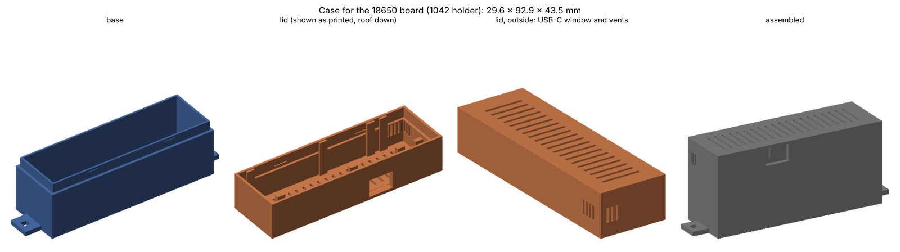
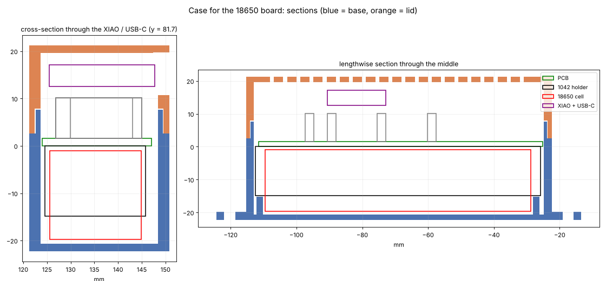

# 3D-printable case

A two-part case (base + lid) for every board size. The STL files in `stl/` are generated by [`tools/make_case.py`](../tools/make_case.py).

| Board | Holder / cell | Print these | Outer size (W x L x H) |
|---|---|---|---|
| 18350 | 1096 / 18350 | `case-18350-base.stl` + `case-18350-lid.stl` | 29.6 x 61.6 x 43.3 mm |
| 18650 | 1042 / 18650 | `case-18650-base.stl` + `case-18650-lid.stl` | 29.6 x 92.9 x 43.5 mm |
| 21700 | 1121 / 21700 | `case-21700-base.stl` + `case-21700-lid.stl` | 30.6 x 90.2 x 46.2 mm |
| Universal, 18350 holder fitted | 1096 / 18350 | `case-universal-18350-base.stl` + `case-universal-lid.stl` | 30.6 x 92.9 x 43.3 mm |
| Universal, 18650 holder fitted | 1042 / 18650 | `case-universal-18650-base.stl` + `case-universal-lid.stl` | 30.6 x 92.9 x 43.5 mm |
| Universal, 21700 holder fitted | 1121 / 21700 | `case-universal-21700-base.stl` + `case-universal-lid.stl` | 30.6 x 92.9 x 46.2 mm |

The three universal bases share one lid; only the ribs and depth under the battery differ. The sizes include the wall-mount tabs on the base ends (9 mm each way).

## How it works
- **Base:** the board drops in battery-side down. Two ribs on the floor press on the battery holder's end walls, so the board sits at a fixed height. The walls end 1 mm above the board, and a thin inner lip continues 5 mm higher for the lid to slide over.
- **Lid:** slides over the lip and clicks onto two small bumps on each long side. Eight short fingers stop 0.3 mm above the board's long edges, so the board can't lift. The fingers are placed automatically clear of every part, the XIAO and the sensor tab.
- **USB-C window** in the lid's right-hand wall, in line with the XIAO's USB-C port (13 x 9 mm, for plugs with an overmold up to about 12.5 x 9 mm). You can charge and flash without opening the case.
- **Vents:** slots across the roof (plug-in sensors, XIAO heat), slots in the left and end walls next to the SHTC3 sensor tab, and three slots in the floor under the tab, so the SHTC3 reads the room's air.
- **Wall mounting:** a tab with a 3.4 mm square hole on each end of the base, for M3 or #4 screws. Set `MOUNT_TABS = False` to remove them.

To open the case, pull the lid straight up. To change the cell, lift the board out of the base.

## Printing
- **Material:** PETG or ASA if the sensor will sit in the sun or near heat; PLA is fine indoors.
- **Orientation:** print the base floor-down and the lid roof-down (the lid STL is already flipped). No supports are needed: the USB-C window and the wall vents are short bridges.
- **Settings:** 0.2 mm layers, 3 walls (perimeters), 15–20 % infill.

## Checks done by the generator
For every case the script checks that no part of the base or lid overlaps:
- the PCB, the battery holder body and the cell;
- every front-side part's courtyard;
- the sockets, the XIAO with its USB-C, and the path of a USB-C plug through the window;
- the space for plug-in sensor boards above the sockets.

It also checks that every STL is watertight with outward-facing facets. All cases pass.

**Not yet test-printed.** The stack heights depend on the parts you use. If the lid doesn't close, or the USB-C window doesn't line up, change these values at the top of `tools/make_case.py` and run `python3 tools/make_case.py`:

| Value | Default | What it is |
|---|---|---|
| `SOCKET_H` | 8.5 mm | height of the female headers on the board |
| `HEADER_SPACER` | 2.5 mm | plastic spacer on the XIAO's male headers |
| `HEADROOM` | 2.5 mm | space above the XIAO (raise for taller plug-in sensors) |
| `CLR`, `CLR_USB` | 0.4 / 1.4 mm | gap around the board, and on the USB side |
| `LIP_GAP` | 0.2 mm | lid-to-lip fit: raise if the lid is too tight |
| `HOLDERS[...]['cell_d']` | 18.5 / 18.7 / 21.4 mm | cell diameter including wrap |
| `MOUNT_TABS` | `True` | wall-mount tabs on the base |
